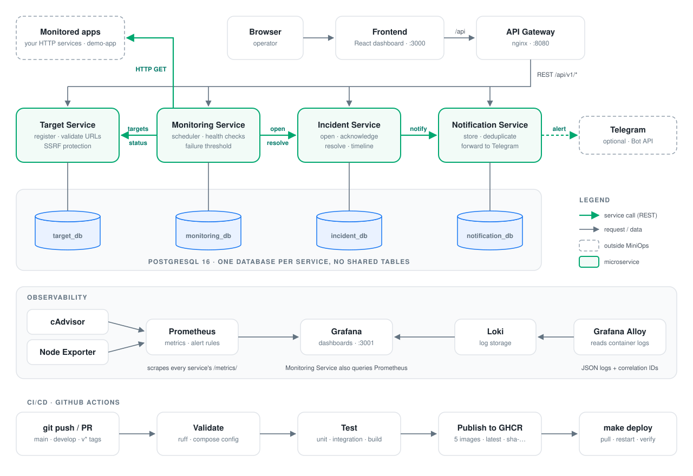

# MiniOps

**A lightweight, distributed infrastructure monitoring platform.**

Register your applications, watch their health and resource use, and manage the resulting incidents from one dashboard. MiniOps is built from four FastAPI microservices, runs entirely on localhost with Docker Compose, and is tested and published by a GitHub Actions pipeline.

> Status: **Version 1 complete.** All ten roadmap phases are done: four services, the dashboard, Docker Compose, CI/CD with integration tests, metrics, centralized logs and Telegram alerts. See the [roadmap](#roadmap).

MiniOps is **open source and local-first**: it runs on your own machine and keeps no accounts. The dashboard has no login on purpose, so do not publish its ports on a public network.

| Document | |
| --- | --- |
| [docs/MiniCloudOps.md](docs/MiniCloudOps.md) | Full specification |
| [docs/REPORT.md](docs/REPORT.md) | Project report |
| [docs/PRESENTATION.md](docs/PRESENTATION.md) | Presentation slides (Marp) |
| [docs/TESTING.md](docs/TESTING.md) | Test strategy and results |
| [docs/architecture.svg](docs/architecture.svg) | Architecture diagram |

---

## Architecture



**Main workflow:** a target is registered → the Monitoring Service checks it on a schedule → results go to the Incident Service → a failure opens an incident → the Notification Service records a notification (and sends it to Telegram, if configured) → the dashboard shows it.

| Service | Responsibility | Database | API base path |
| --- | --- | --- | --- |
| `target-service` | Register and manage monitored applications | `target_db` | `/api/v1/targets` |
| `monitoring-service` | Run health checks, query Prometheus, report results | `monitoring_db` | `/api/v1/monitoring` |
| `incident-service` | Open, track and resolve incidents | `incident_db` | `/api/v1/incidents` |
| `notification-service` | Create and track notifications; forward them to Telegram | `notification_db` | `/api/v1/notifications` |

Each service owns its database and never queries another service's database. Services refer to each other's data by ID and talk over REST.

## Tech stack

| Layer | Technology |
| --- | --- |
| Frontend | React 18 + Vite, TanStack Query, Framer Motion; served by nginx |
| Backend | Python 3.12, FastAPI, SQLAlchemy 2 |
| Database | PostgreSQL 16 (one container, four databases) |
| Gateway | nginx |
| Metrics | Prometheus, cAdvisor, Node Exporter |
| Logs | Grafana Alloy → Loki |
| Dashboards | Grafana |
| Containers | Docker, Docker Compose |
| CI/CD | GitHub Actions → GitHub Container Registry (GHCR) |
| Testing | Pytest (unit, API and integration), Demo Lab scenarios |
| Alerts | Dashboard, desktop notifications, Telegram Bot API (optional) |

## Quick start

**Prerequisites:** Docker with Compose v2, `make`, and (for local development) Python 3.12 and Node 20.

```bash
git clone https://github.com/LK-Hour/MiniCloudOps.git miniops && cd miniops
make env          # creates .env from .env.example — change the passwords
make up           # builds and starts the whole stack
make health       # waits until every service reports healthy
```

| URL | What |
| --- | --- |
| http://localhost:3000 | MiniOps dashboard |
| http://localhost:8080 | API gateway |
| http://localhost:3001 | Grafana (login from `.env`) |
| http://localhost:9090 | Prometheus |

The microservices are not published to the host. To browse a service's OpenAPI docs (`/docs`), run it locally as shown in [Development](#development).

To also start the **Demo Lab** sandbox (an app whose health the dashboard can break on purpose): `make demo`. A plain healthy app is then available to register as `http://demo-app/`.

### Telegram alerts (optional)

Each new incident and each recovery can also be sent to a Telegram chat:

1. Create a bot with [@BotFather](https://t.me/BotFather) and copy its token.
2. Send your bot a message (or add it to a group). Then open `https://api.telegram.org/bot<TOKEN>/getUpdates` and copy the `chat.id`.
3. Put both values in `.env`, then restart the service with `docker compose up -d notification-service`:

   ```bash
   TELEGRAM_BOT_TOKEN=123456:ABC...
   TELEGRAM_CHAT_ID=123456789
   ```
4. Dashboard → **Settings → Notifications → Telegram alerts → Send test**.
5. Optional: set `ALERT_TIMEZONE` (an IANA name such as `Asia/Phnom_Penh`) to show times in your zone. The default is UTC.

What a critical alert looks like:

```
🔴 CRITICAL · Incident opened

Shop API is unavailable

Target    Shop API
URL       http://shop-api:8000/health
Failure   HTTP 503 · Service Unavailable
Response  12 ms
Streak    3 failed checks in a row (threshold 3)
Checked   every 30 s
Failing   16:16:34 +07 · 16 Nov (1 min 30 s ago)

📊 Latest checks (newest first)
✗ 503  ✗ 503  ✗ 503  ✓ 200

🔎 Likely cause
The app reports itself unavailable: overloaded, in maintenance, or a dependency it needs is down.

🛠 What to check
• The app's error logs at the time of the check
• Its dependencies (database, cache, other services)
• Recent deploys or configuration changes

🆔 Incident 1610583c · Open in MiniOps
```

How the template works:

- **Header and sound by severity.** 🔴 CRITICAL and 🟠 WARNING alerts make a sound. 🔵 INFO alerts and ✅ RESOLVED messages arrive silently.
- **Likely cause and what to check** depend on how the check failed:
  - timeout, DNS failure (for example a stopped container), connection refused, TLS certificate, broken HTTP, blocked by SSRF protection
  - for HTTP errors, the status code: 500, 502, 503, 504, 401, 403, 404, 405 and 429 each have their own explanation
- **The resolved message** shows the target, the current status and response time, the downtime, and the start and end times.
- **The link** opens the incident in the dashboard (`#/incidents/<id>`).

#### Bot commands

Type `/` in the chat with your bot to see the commands:

| Command | What it does |
| --- | --- |
| `/status` | Overview: targets up, down and paused; open and acknowledged incidents; service health; whether alerts make a sound; what is down now |
| `/menu` | Main menu with buttons (also `/start`) |
| `/targets` | Every target, worst first, with its response time. Tap one for its details, latest checks and **Check now** |
| `/incidents` | Active incidents with **Ack** and **Resolve** buttons |
| `/check <name>` | Run a health check now. Matches part of the name, for example `/check shop`; with no name it lists the targets |
| `/services` | Readiness of the four MiniOps services |
| `/quiet 30` · `/quiet off` | Alerts arrive without sound for 30 minutes (up to 24 h). They still arrive |
| `/help` | The list above |

Alerts carry buttons too:

- **✅ Acknowledge:** acknowledges the incident and records who did it, for example "Acknowledged in Telegram by Kim".
- **▶ Check now:** runs a fresh check and replies with the result.
- **📊 Status**

Menu buttons update the same message instead of sending new ones.

How it works:

- **Polling.** MiniOps is local, so Telegram cannot call it with a webhook. The Notification Service long-polls Telegram instead, and reads the Target, Monitoring and Incident services over the internal network to answer.
- **Private.** The bot answers only `TELEGRAM_CHAT_ID`. Other chats are ignored and logged, and their button presses are refused.
- **No late answers.** Commands sent while MiniOps was down are not answered when it comes back.
- **Quiet mode** is kept in memory, so a restart turns sound back on.
- **Turning it off.** Set `TELEGRAM_COMMANDS_ENABLED=false` for alerts only, with no buttons.

Usage is counted in `miniops_telegram_commands_total{command}`.

Where the details come from:

1. The Monitoring Service sends a `context` with the incident: target name and URL, `failure_kind`, error, status code, response time, failure streak and threshold, check interval and timeout, when the failures started, and the last 5 checks.
2. The Incident Service adds `started_at` and, on resolution, `resolved_at` and `duration_seconds`.
3. It passes everything to the Notification Service as `details`.

`details` is used only to render the alert. It is not stored, so no database tables changed. A notification with no details, such as an incident created by hand through the API, falls back to its title and message. The templates are in [app/alert_templates.py](services/notification-service/app/alert_templates.py).

The dashboard stays the source of truth. A notification is stored first and then sent to Telegram in the background, so a slow or unreachable Telegram never delays an incident. A notification that the Incident Service sends again is not delivered twice. The bot token is never logged. Results are counted in `miniops_telegram_deliveries_total{result="sent|failed"}`.

Stop with `make down`. `make clean` also deletes all data volumes.

Run `make help` for every command.

## Project structure

```
.
├── frontend/                   React dashboard (Vite) + nginx config
├── gateway/nginx.conf          API gateway routes
├── services/
│   ├── target-service/
│   ├── monitoring-service/
│   ├── incident-service/
│   └── notification-service/
│       ├── app/
│       │   ├── main.py           FastAPI app, /health, /health/ready, /metrics
│       │   ├── routes.py         API endpoints (contract from the spec)
│       │   ├── schemas.py        Pydantic request/response models
│       │   ├── models.py         SQLAlchemy tables
│       │   ├── db.py             Engine, sessions, readiness check
│       │   ├── config.py         Settings from environment variables
│       │   ├── logging_config.py JSON logs with correlation IDs
│       │   ├── middleware.py     Correlation-ID + request logging
│       │   ├── errors.py         Standard error responses
│       │   └── http_client.py    Service-to-service calls with retry/backoff
│       ├── tests/
│       ├── Dockerfile
│       ├── requirements.txt
│       └── requirements-dev.txt
├── infrastructure/
│   ├── prometheus/             prometheus.yml, alert-rules.yml
│   ├── grafana/                provisioning/ + dashboards/
│   ├── loki/loki-config.yml
│   └── alloy/config.alloy
├── database/init.sh            Creates the four databases and their users
├── demo-app/lab.py             Sandbox app for the Demo Lab and integration tests
├── tests/integration/          End-to-end tests against the running stack
├── scripts/healthcheck.sh      Post-deploy health verification
├── docs/                       Specification, report, slides, testing, architecture diagram
├── .github/                    CI/CD workflow, PR and issue templates
├── docker-compose.yml
├── Makefile
└── .env.example
```

## Development

Work on one service without Docker:

```bash
cd services/target-service
python3.12 -m venv .venv && source .venv/bin/activate
pip install -r requirements-dev.txt
uvicorn app.main:app --reload --port 8001     # http://localhost:8001/docs
pytest
```

Frontend with hot reload (expects the gateway on :8080):

```bash
cd frontend && npm install && npm run dev       # http://localhost:5173
```

### Dashboard

A sidebar groups the pages into **Monitor**, **Lab**, **Resources** and **System**. Press `Ctrl K` (`⌘ K` on macOS) to search pages, targets, incidents and docs. Keys `1`–`9` switch pages, and every page has its own URL (`/#/incidents`, `/#/docs/api-target`).

| Page | Shows | Actions |
| --- | --- | --- |
| Overview | Targets up, open incidents, average response, unread notifications; health strip per target; host CPU/memory/disk | Click through to any item |
| Targets | Status, consecutive failures, response time, trend, last check | Add, edit, delete, enable/disable, check now; drawer with response chart, container CPU/memory and check history |
| Incidents | Active / open / acknowledged / resolved, with duration | Drawer with timeline; acknowledge, resolve |
| Notifications | Grouped by day, unread marked | Mark read (opens the incident), mark all read |
| Infrastructure | Host usage and uptime, firing alerts, MiniOps service status, per-container CPU and memory | Sort containers |
| Demo Lab | Scenarios, Microservices, Logs and CI/CD tabs (see below) | Run experiments, search logs, connect the GitHub repository |
| Documentation | Guides (getting started, concepts, incident lifecycle, metrics, troubleshooting, shortcuts) and an API reference generated from each service's live OpenAPI document | Copy example `curl` commands |
| Settings | Theme, animations, refresh interval, start page, desktop alerts, Telegram status; the monitoring policy in effect (read-only) | Send a test alert, reset preferences |
| About | Version and build commit, live status and version of every service and platform component, architecture, stack, team | Links to Grafana and Prometheus |

Data refreshes every 5 s by default (adjustable or paused in Settings) and pauses while the browser tab is hidden. The sidebar shows **Live**, **Degraded** (hover to see which API is failing), **Offline** or **Paused**. Each panel fails on its own. Missing metrics show as "no data", never as 0. Preferences live in the browser's local storage.

Endpoints added for the dashboard:

- `GET /api/v1/monitoring/targets`: every target's state and latest checks, in one call.
- `GET /api/v1/monitoring/infrastructure`: host, containers, service status and alerts from Prometheus.
- `GET /api/v1/monitoring/config`: the monitoring policy (thresholds, intervals), read-only.
- `GET /api/v1/notifications/channels`: which delivery channels are on (dashboard, Telegram).
- `POST /api/v1/notifications/channels/telegram/test`: send a test message to Telegram.
- `GET /api/docs/<service>-service.json` (gateway): each service's OpenAPI document, for the API reference.

#### Demo Lab

Shows the platform working, against the live stack, not mocks.

- **Scenarios.** Eight experiments, each with a hypothesis, live steps, assertions, a request console and a pass/fail verdict with measurements (time to detect, outage duration, …). Every request of a run carries one correlation ID (`lab-…`), so **Logs for this run** shows it crossing all services.
  - End-to-end: outage detection & recovery, alert debouncing, latency & timeouts, intermittent errors.
  - API contract: idempotency and the incident state machine.
  - Security: SSRF targets, invalid input, internal-only routes.
  - Resilience (needs a terminal): Notification Service outage, Incident Service outage. The lab shows the `docker compose stop/start` command and waits for it.

  Scenarios that break things use the sandbox (`make demo`): [demo-app/lab.py](demo-app/lab.py), a standard-library Python app whose endpoints can be set to fail, slow down or flake through `/api/v1/lab/endpoints/{name}`. Lab targets are deleted after the run (or kept, if asked) and their notifications marked read; incidents stay in the history.
- **Microservices.** Live service map, then per service: purpose, guarantees, dependencies and what happens when each is down, owned tables, live CPU/memory, endpoints, configuration, metrics and recent logs.
- **Logs.** Search Loki by service, level, text and correlation ID, with a volume chart and live tail; any line's correlation ID can be followed across services. Links to Grafana Explore.
- **CI/CD.** The pipeline from `.github/workflows/ci-cd.yml`, image tags, registry, local equivalents. Enter the public repository (`owner/name`) to colour the jobs with live GitHub Actions results; the browser calls api.github.com directly (60 requests/hour without a token).

Gateway routes for the Demo Lab: `/api/v1/lab/…` (sandbox control; 503 when the sandbox is not running) and read-only `GET /api/v1/logs/{query_range,labels,label/<name>/values}` (Loki).

The image records its build commit: CI passes `GIT_SHA`, and local builds use `GIT_SHA=$(git rev-parse --short HEAD) docker compose build frontend`.

### Conventions every service follows

- **Health:** `GET /health` (liveness) and `GET /health/ready` (database reachable).
- **Metrics:** Prometheus metrics at `GET /metrics/`.
- **Logs:** one JSON object per line with `timestamp`, `level`, `service`, `correlation_id`, `message`.
- **Correlation IDs:** the `X-Correlation-ID` header is accepted, generated when missing, returned in the response and forwarded on outbound calls.
- **Errors:** `{"error": {"code", "message", "details", "correlation_id"}}`.
- **Config:** environment variables only. No secrets in code or logs.
- **Internal endpoints:** `PATCH /api/v1/targets/{id}/status` is for the Monitoring Service only. The gateway returns 404 for it.

### Target URL safety (SSRF)

The Target Service refuses URLs the platform should never call: loopback, link-local and cloud metadata (`169.254.169.254`), MiniOps's own containers (by name or IP), and URLs with embedded credentials. Private addresses are allowed by default because apps in Docker Compose use them. Set `SSRF_ALLOW_PRIVATE_NETWORKS=false` to allow public addresses only. The rules are in [services/target-service/app/url_safety.py](services/target-service/app/url_safety.py).

The Monitoring Service checks the URL again before every request, so a DNS name that later points somewhere internal is still blocked. It also never follows redirects and ignores proxy environment variables.

### How a health check flows

1. Every 5 seconds the Monitoring Service asks the Target Service for enabled targets and starts a check for each one that is due (`check_interval`, default 30 s). `POST /api/v1/monitoring/check/{id}` runs one immediately.
2. The check is a `GET` with a 5 s timeout. A 2xx or 3xx answer is `UP`; anything else, a timeout or a DNS failure is `DOWN`. Response time is `null` when no answer arrived, never `0`.
3. The result goes to `health_checks` (kept 7 days), and the status goes to the Target Service.
4. After `FAILURE_THRESHOLD` (default 3) failures in a row, the Monitoring Service opens a `CRITICAL` incident. The incident's ID is stored with the target's state, so a long outage opens one incident, even across restarts. The first `UP` resolves it.
5. The Incident Service saves the incident, then notifies the Notification Service in the background. It allows only one unresolved incident per target, enforced by a unique index too. Notifications are deduplicated per incident and event.

When something is down:

| Down | What happens |
| --- | --- |
| Monitored app | Checks record `DOWN`; an incident opens after the threshold |
| Incident Service | Calls are retried 3 times with backoff, then again on the next check |
| Notification Service | The incident is saved; `NOTIFICATION_FAILED` appears in its history |
| Target Service | The scheduler skips the round and changes nothing |
| Prometheus | `metrics_available: false`, CPU and memory `null` |

Disabling or deleting a target resolves its open incident. One check carries one correlation ID (`check-…`) through all four services, so you can follow it in Loki.

See [CONTRIBUTING.md](CONTRIBUTING.md) for branching, commits and pull requests.

## Testing

```bash
make test          # 150 unit + API tests across the four services (pytest)
make lint          # ruff
make demo          # start the stack with the sandbox app, then:
make integration   # 14 end-to-end tests through the gateway (about 20 s)
```

The integration tests register a target against the sandbox, break it, and check the whole chain: no incident below the threshold, exactly one incident at it, an `INCIDENT_CREATED` notification, automatic resolution with an `INCIDENT_RESOLVED` notification, and one correlation ID followed through three services in Loki. They also cover SSRF blocking, input validation and the read-only log API. They clean up after themselves. CI runs them on the full stack before any image is published.

Details and results: [docs/TESTING.md](docs/TESTING.md).

## Observability

- **Metrics:** Grafana → *MiniOps / MiniOps Overview* dashboard, in five rows:
  - **Overview:** active targets, open incidents, check failures, availability, services up, API request rate.
  - **Monitored targets** (by name): p95 response time, availability, checks per minute.
  - **MiniOps APIs** (per service): request rate, p95 latency, 5xx errors.
  - **Containers:** CPU and memory.
  - **Logs:** warnings and errors from Loki.

  | Metric | From | Labels |
  | --- | --- | --- |
  | `miniops_health_check_total`, `miniops_health_check_failures_total` | Monitoring | `target_id` |
  | `miniops_http_response_time_seconds` (histogram) | Monitoring | `target_id` |
  | `miniops_target_info` | Monitoring | `target_id`, `name` (join to show names) |
  | `miniops_active_targets`, `miniops_open_incidents` | Monitoring | |
  | `miniops_api_requests_total` | every service | `service`, `method`, `route`, `status` |
  | `miniops_api_request_duration_seconds` (histogram) | every service | `service`, `method`, `route` |
  | `miniops_telegram_deliveries_total` | Notification | `result` |

  `route` is the route template (`/api/v1/targets/{target_id}`), never the raw path, so the number of series stays bounded.
- **Logs:** Grafana → Explore → Loki. Follow one request across services:

  ```logql
  {compose_project="miniops"} | json | correlation_id="req-12345"
  ```

- **Alert rules:** [infrastructure/prometheus/alert-rules.yml](infrastructure/prometheus/alert-rules.yml) (demo thresholds: CPU > 80 %, memory > 85 %).

## CI/CD

[.github/workflows/ci-cd.yml](.github/workflows/ci-cd.yml) runs on every push and pull request:

1. **Validate:** ruff lint and `docker compose config`.
2. **Test:** pytest for each service and a frontend build, then the **integration tests on the full stack** (`docker compose --profile demo up --wait`).
3. **Build:** a Docker image for each service and for the frontend, only when every test job passed.
4. **Publish:** on push (not PRs), images go to `ghcr.io/<owner>/miniops-<service>`, tagged `latest` (default branch), the branch name, `sha-<commit>`, and the version for `v*` tags.
5. **Local run:** on the demo machine, set `GHCR_OWNER` in `.env` and run `make deploy` (pull, restart, health check).

## Team

| Role | Owns |
| --- | --- |
| Backend Engineer 1 | `target-service` |
| Backend Engineer 2 | `monitoring-service` |
| Backend Engineer 3 | `incident-service`, `notification-service` |
| DevOps & Observability Engineer | Docker, Compose, CI/CD, Prometheus, Grafana, Loki |
| Frontend Engineer | Dashboard and API integration |

## Roadmap

- [x] 1. Planning: requirements, architecture, API design
- [x] 2. Foundation: repository, FastAPI skeletons, database setup
- [x] 3. Microservices: implement the four services
- [x] 4. Integration: connect services and databases
- [x] 5. Containerization: Dockerfiles and Compose
- [x] 6. Monitoring: Prometheus, exporters, Grafana
- [x] 7. Logging: Loki and Alloy
- [x] 8. CI/CD: GitHub Actions and GHCR
- [x] 9. Local run: full stack on localhost
- [x] 10. Validation: failure tests and final documentation

**Not planned:** user accounts and login (MiniOps is local-only by design), cloud hosting, Kubernetes, distributed tracing. Ideas for later: email alerts, monitoring several machines.

## License

[MIT](LICENSE)
