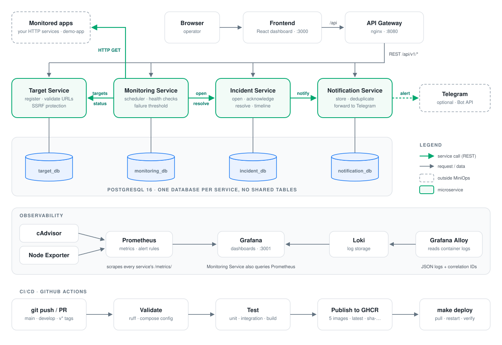

<!-- _class: lead -->
<!-- _paginate: false -->

# MiniOps

## A lightweight microservices monitoring platform

DevOps Project · CADT Year 4 · 2026

<!-- Speaker (0:00–0:30): introduce the team and the one-line pitch. -->

---

# The problem

- Small teams run many apps: APIs, sites, background workers
- When one goes down, they hear it **from a user**
- Full monitoring suites are expensive, slow to set up, and hide the mechanics

**MiniOps:** register a URL, and get checks, incidents and alerts, on your own machine, with one command.

**For:** developers, DevOps learners, sysadmins, small teams.

<!-- Speaker (0:30–1:15): who suffers and why existing tools are overkill for them. -->

---

# What it does

1. **Register** an application's URL
2. **Check** it on a schedule (UP / DOWN, response time)
3. **Open an incident** after 3 failures in a row: one per outage, never duplicates
4. **Notify** on the dashboard and in **Telegram**
5. **Resolve** on its own when the app recovers

Plus container CPU/memory, centralized logs and Grafana dashboards.

<!-- Speaker (1:15–2:00): walk through the five verbs; mention the demo comes later. -->

---

# Architecture



<!-- Speaker (2:00–3:15): browser → frontend → gateway → 4 services; one DB each; green arrows = REST calls between services; observability band; CI/CD band. -->

---

# Four services, one job each

| Service | Does | Owns | Calls |
| --- | --- | --- | --- |
| **Target** | Register targets, validate URLs (SSRF protection) | `target_db` | — |
| **Monitoring** | Scheduler, health checks, failure threshold, metrics | `monitoring_db` | Target, Incident, Prometheus |
| **Incident** | Incident state machine and timeline | `incident_db` | Notification |
| **Notification** | Store and deduplicate notifications, send to Telegram | `notification_db` | Telegram |

**Why split?** Each step changes for a different reason, and **failures stay contained**:
Notification down → incidents still saved · Incident down → retried next check · Target down → one round skipped.

<!-- Speaker (3:15–4:15): justify the decomposition with the failure-isolation table. -->

---

# Implementation

- **Python 3.12 · FastAPI · SQLAlchemy · PostgreSQL 16**: one database and one user per service, no shared tables
- **REST** under `/api/v1`, validated with Pydantic, one standard error body, OpenAPI docs
- **Service calls:** 5 s timeout, 3 retries with backoff, idempotent (retries never duplicate)
- **Correlation ID** on every request, carried through all four services
- **Security:** SSRF blocking, secrets only in `.env`, internal routes hidden by the gateway, services run as non-root
- **React dashboard** with a Demo Lab of 8 live failure experiments

<!-- Speaker (4:15–5:00): pick two: service-owned data and idempotent retries. -->

---

# DevOps workflow

**Docker Compose:** 13 containers, two networks, healthchecks, restart policies, volumes, `make up`

**GitHub Actions** on every push and PR:

```
validate ─► unit tests ×4 ─► integration (full stack) ─► build ─► publish to GHCR
            frontend build ──────────────────────────────┘
```

**Deploy:** `make deploy` pulls the images from GHCR, restarts and runs health checks. Local and open source by design.

<!-- Speaker (5:00–6:00): show the Actions run and the GHCR packages page. -->

---

# Observability

| | Tool | Shows |
| --- | --- | --- |
| Metrics | Prometheus + cAdvisor + Node Exporter | Availability, response time, API request rate, p95 latency, 5xx errors, CPU, memory |
| Dashboards | Grafana *MiniOps Overview* | 5 rows: overview, targets, APIs, containers, logs |
| Logs | Alloy → Loki | JSON logs from every container, searchable by service, level and correlation ID |
| Alerts | Prometheus rules, Telegram | High CPU or memory, service down, new and resolved incidents |

<!-- Speaker (6:00–6:45): open Grafana, point at the availability and API rows. -->

---

# Live demo: an outage, end to end

1. Demo Lab → **Outage detection & recovery** → Run
2. The sandbox app starts answering `503`
3. 3 failed checks → **incident opens** → notification → **Telegram alert**
4. The app recovers → incident **resolved** automatically
5. **Logs for this run**: one correlation ID crosses all four services

<span class="small">Backup: `make integration` runs the same flow as an automated test.</span>

<!-- Speaker (6:45–8:45): run it live; keep Grafana open in a second tab to show the spike. -->

---

# Investigating an error with logs

**Scenario:** the Notification Service is stopped, then a target fails.

- Dashboard: an incident appears, but no notification
- Incident timeline: `NOTIFICATION_FAILED`
- Loki, filtered by the correlation ID: failed checks → `Incident opened` → 3 attempts to reach the Notification Service → the error

The same method found **two real bugs**: checks taking 6 s (a DNS timeout, now 50 ms) and retries of a container that no longer existed.

<!-- Speaker (8:45–9:30): the logs tell the story in order; this is why correlation IDs matter. -->

---

# Results

| | |
| --- | --- |
| Unit and API tests | **150 passed** |
| Integration tests (live stack) | **14 passed** |
| Demo Lab scenarios | **8 of 8 passed** |
| Images | 5, published to GHCR on every green push to `main` |

**Next:** email alerts, multiple machines, OpenTelemetry tracing.

<!-- Speaker (9:30–10:00): wrap up, thank the audience, take questions. -->

---

<!-- _class: lead -->
<!-- _paginate: false -->

# Thank you

**github.com/LK-Hour/MiniCloudOps**

Questions?
