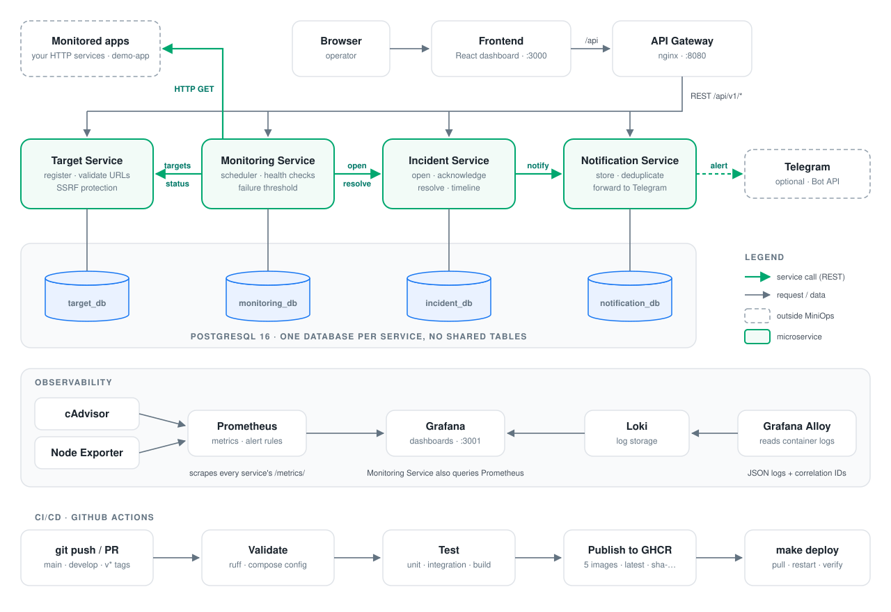

# MiniOps: A Lightweight Microservices Monitoring Platform

**DevOps Project Report** · CADT, Year 4 Term 1 · 2026

| Team member | Role | Contribution |
| --- | --- | --- |
| Loem Kimhour | Backend Engineer | Target Service |
| Loem Kimhour | Backend Engineer | Monitoring Service |
| Loem Kimhour | Backend Engineer | Incident and Notification services |
| Loem Kimhour | DevOps & Observability Engineer | Docker, Compose, CI/CD, Prometheus, Grafana, Loki |
| Loem Kimhour | Frontend Engineer | Dashboard and API integration |

## Links

| What | Where |
| --- | --- |
| Source code | https://github.com/LK-Hour/MiniCloudOps |
| CI/CD pipeline runs | https://github.com/LK-Hour/MiniCloudOps/actions |
| Container images (GHCR) | https://github.com/LK-Hour?tab=packages · `ghcr.io/lk-hour/miniops-{target,monitoring,incident,notification}-service`, `ghcr.io/lk-hour/miniops-frontend` |
| Running application | Local deployment: http://localhost:3000 (dashboard), :8080 (API gateway), :3001 (Grafana), :9090 (Prometheus) |
| Specification | [docs/MiniCloudOps.md](MiniCloudOps.md) |
| Testing documentation | [docs/TESTING.md](TESTING.md) |

## 1. Project overview

**Problem.** Small teams and students run several applications at once: APIs, websites, background services. When one of them stops responding, they usually find out from a user. Full monitoring suites such as Datadog, or a self-hosted Prometheus stack with Alertmanager, can solve this. But they are expensive or take a long time to set up, and they hide the basic mechanics a learner needs to see.

**Solution.** MiniOps is a small, self-hosted monitoring platform:

- You register the URL of an application.
- MiniOps checks it on a schedule, records each result, and opens an incident when it fails several times in a row.
- It notifies you on the dashboard and, optionally, in Telegram.
- It resolves the incident on its own when the application recovers.

A single `make up` starts it on one machine with Docker Compose.

**Users.** Developers, DevOps learners, system administrators and small teams who want uptime monitoring and incident tracking without a cloud account.

**Scope.** Version 1 covers:

- HTTP health checks, incidents and notifications
- container CPU and memory metrics
- centralized logs
- a web dashboard
- automated build and publishing

MiniOps is open source and runs locally by design. It has no user accounts, so it should not be exposed on a public network.

## 2. Architecture

*Figure 1. The browser talks to a React dashboard. The dashboard calls one nginx API gateway, which routes to four FastAPI microservices. Each service owns its own PostgreSQL database. The services call each other over REST, shown as green arrows. Prometheus, Loki, Alloy and Grafana observe everything. GitHub Actions builds the images and publishes them to GHCR.*

### 2.1 Services and why the application is split this way

The application is split along the four steps of the monitoring workflow. Each step changes for different reasons and fails in different ways:

| Service | Responsibility | Owns (database) | Calls |
| --- | --- | --- | --- |
| **Target** | Registers the applications to monitor and validates their URLs, including SSRF protection | `target_db`: targets | — |
| **Monitoring** | Runs the scheduler and health checks, counts consecutive failures, and decides when an incident opens or resolves. Also reads container metrics from Prometheus | `monitoring_db`: health checks, target state | Target, Incident, Prometheus |
| **Incident** | Keeps the incident record and its state machine (OPEN → ACKNOWLEDGED → RESOLVED) with a timeline | `incident_db`: incidents, events | Notification |
| **Notification** | Stores one notification per incident event and forwards it to Telegram | `notification_db`: notifications | Telegram (optional) |

The split gives each service a single reason to change, and contains failures:

- **Notification Service down:** incidents are still recorded.
- **Incident Service down:** monitoring continues and retries on the next check.
- **Target Service down:** the scheduler skips one round instead of crashing.

The Demo Lab demonstrates each of these behaviours.

### 2.2 How a request flows

1. Every 5 s, the Monitoring Service asks the Target Service for enabled targets that are due (`GET /api/v1/targets`).
2. It sends `GET` to the target's URL with a 5 s timeout. A 2xx or 3xx answer is UP. Anything else, or a timeout, is DOWN. It stores the result and reports the status back to the Target Service (`PATCH /targets/{id}/status`).
3. After 3 failures in a row, which is a configurable threshold, it calls `POST /api/v1/incidents`. The Incident Service allows one active incident per target, enforced by a unique index.
4. The Incident Service calls `POST /api/v1/notifications` in the background. The Notification Service deduplicates by incident and event, stores the notification, then sends it to Telegram.
5. The first successful check resolves the incident (`PATCH /incidents/{id}/status`), which produces an `INCIDENT_RESOLVED` notification.

Every call carries an `X-Correlation-ID` header. One check keeps the same ID through all four services, so its whole path can be found in the logs.

## 3. Technology stack

| Layer | Technology | Why |
| --- | --- | --- |
| Services | Python 3.12, FastAPI, SQLAlchemy 2, Pydantic, httpx | Typed request validation, automatic OpenAPI docs, async HTTP between services |
| Database | PostgreSQL 16: one container, four databases, four users | Each service can only access its own data |
| Gateway | nginx | One entry point, routing, an internal route blocked from outside, timeouts, a standard 503 |
| Frontend | React 18, Vite, TanStack Query | Live dashboard with polling, served as static files by nginx |
| Containers | Docker, Docker Compose | Whole stack with one command, with healthchecks and restart policies |
| CI/CD | GitHub Actions, GitHub Container Registry | Lint, test, integration test, build, publish |
| Metrics | Prometheus, cAdvisor, Node Exporter, Grafana | Service, container and host metrics, and dashboards |
| Logs | Grafana Alloy → Loki → Grafana | Container logs collected without changing any service |
| Alerts | Telegram Bot API | Incident alerts on a phone |

## 4. Implementation

**REST APIs.** All services follow the same conventions:

- **Versioned paths** under `/api/v1`.
- **Validation:** Pydantic models reject bad input with 422 and one error per field.
- **Errors** use a standard body, `{"error": {code, message, details, correlation_id}}`.
- **Health:** `/health` for liveness and `/health/ready` to check the database.
- **Metrics** at `/metrics/`.
- **Docs:** each service publishes its OpenAPI document, and the dashboard renders it as an API reference.

**Service-owned data.** Each service connects with its own database user, which has rights on its own database only. No service reads another service's tables. Services refer to each other's records by ID. For example, an incident stores a `target_id`, but there is no foreign key across databases.

**Service-to-service communication.** All calls go through one shared HTTP client:

- 5 s timeouts.
- Up to 3 attempts with exponential backoff, on network errors and 5xx responses only.
- No retries when the host name does not resolve, which means the container is gone.
- The correlation ID is forwarded on every call.

Calls are idempotent where retries are possible:

- Reporting the same incident twice returns the existing one.
- Notifying twice returns the stored notification with `200`.

**Security.**

- The Target Service blocks SSRF. It refuses URLs that resolve to loopback, link-local or cloud-metadata addresses, or to MiniOps's own containers, and URLs with embedded credentials.
- The Monitoring Service checks the URL again before every request and never follows redirects.
- Passwords and the Telegram token come only from `.env`, which git ignores, and are never logged.
- PostgreSQL and the services are not published to the host. Only the gateway, the dashboard, Grafana and Prometheus are.
- The four service containers run as a non-root user.

**Dashboard.** Pages:

- **Overview:** status at a glance.
- **Targets:** register, check now, history and charts.
- **Incidents:** timeline, acknowledge, resolve.
- **Notifications.**
- **Infrastructure:** host and container usage, firing alerts.
- **Documentation.**
- **Demo Lab:** eight scripted failure experiments, a live service map, log search, and the CI/CD pipeline with live GitHub results.

## 5. DevOps workflow

**Containerization.**

- Every service has a small `python:3.12-slim` Dockerfile that runs as a non-root user with a healthcheck.
- The frontend is built in a multi-stage Dockerfile and served by nginx.
- `docker-compose.yml` defines 13 containers on two networks: an internal one for services and data, and a public one for the edge.
- It sets restart policies, named volumes for PostgreSQL, Prometheus, Loki and Grafana, and healthcheck-based startup order.
- A `demo` profile adds the sandbox app used for failure tests.

**CI/CD pipeline** (`.github/workflows/ci-cd.yml`). It runs on every push and pull request:

1. **Validate:** `ruff` lint and `docker compose config`.
2. **Test:** 150 unit and API tests across the four services in parallel, plus a production build of the frontend.
3. **Integration:** starts the whole stack in the runner and runs 14 end-to-end tests through the gateway.
4. **Build and publish:** builds 5 images with layer caching. On pushes, not on pull requests, it publishes them to GHCR with these tags:
   - `latest` (default branch)
   - the branch name
   - `sha-<commit>`
   - the version, for `v*` tags

   Publishing depends on every test job, so a broken commit never produces an image.

**Deployment.** Deployment is local by design: it targets the machine that runs MiniOps, not a cloud provider. `make deploy`:

- pulls the published images from GHCR, so nothing is built locally;
- recreates the containers;
- runs `scripts/healthcheck.sh` to verify every service.

`IMAGE_TAG` in `.env` pins a version, which makes rollback a one-line change.

## 6. Observability

**Metrics.** Prometheus scrapes three sources:

- every service's `/metrics/`
- cAdvisor, for containers
- Node Exporter, for the host

It also evaluates alert rules: high container CPU or memory, high host memory, and a MiniOps service down. The provisioned Grafana dashboard **MiniOps Overview** has five rows:

| Row | Panels | What it reveals |
| --- | --- | --- |
| Overview | Active targets, open incidents, check failures (5 min), availability (1 h), services up, API requests/s | Is anything wrong right now? |
| Monitored targets | p95 response time, availability and checks per minute, by target name | Which application is slow or failing, and since when |
| MiniOps APIs | Request rate, p95 latency, 5xx errors, per service | Whether MiniOps itself is healthy and how loaded it is |
| Containers | CPU % and memory per container | Resource use, and leaks or spikes after a deploy |
| Logs | Warnings and errors from Loki | The reason behind a spike in the panels above |

Custom metrics:

- `miniops_health_check_total` and `miniops_health_check_failures_total`
- `miniops_http_response_time_seconds`, a histogram
- `miniops_api_requests_total` and `miniops_api_request_duration_seconds`, labelled by route template to keep the number of series bounded
- `miniops_target_info`, which maps target IDs to names
- `miniops_telegram_deliveries_total`

**Centralized logs.** Every service writes one JSON object per line: `timestamp`, `level`, `service`, `correlation_id`, `message` and extra fields. Grafana Alloy reads all container logs from Docker and ships them to Loki with the labels `service`, `container` and `level`. Logs can be searched in Grafana Explore or in the dashboard's Demo Lab → Logs tab.

**Investigating an error with logs (demonstrated).**

1. The Demo Lab's "Notification Service outage" scenario stops the Notification Service and then breaks a target.
2. The dashboard shows a new incident, but no notification arrives.
3. The incident's timeline shows `NOTIFICATION_FAILED`.
4. Searching Loki for that incident's correlation ID shows the whole story in order:
   - the Monitoring Service's failed checks
   - its `Incident opened` line
   - the Incident Service's warnings that each of its 3 attempts to reach the Notification Service failed
   - the final error
5. Restarting the service and running a check shows the next notification delivered under a new correlation ID.

The same method found two real bugs during development:

- **Slow checks.** The logs showed each check taking about 6 s. They traced it to a DNS lookup timing out on every check. A cache fixed it, and a check now takes about 50 ms.
- **Failing manual checks.** The logs showed manual checks failing during an Incident Service outage. They traced it to retries of a host name that no longer existed. A missing host name is no longer retried.

## 7. Testing and results

| Suite | Result |
| --- | --- |
| Unit and API tests (pytest, SQLite and mocked HTTP) | 150 passed |
| Integration tests (live stack, through the gateway) | 14 passed, about 20 s |
| Demo Lab scenarios | 8 of 8 passed |

The main integration test runs the specified workflow end to end:

1. Register a target.
2. Break it.
3. Below the threshold, no incident opens.
4. At the threshold, exactly one incident opens and a notification is stored.
5. Repeated failures open no duplicate.
6. On recovery, the incident is resolved automatically and a second notification is stored.
7. The test's correlation ID appears in Loki from three services.

Details are in [TESTING.md](TESTING.md).

## 8. Conclusion and future work

MiniOps meets the project requirements:

- four independent services with their own REST APIs and databases, communicating over REST;
- a Dockerfile per service and one Compose file for the whole stack;
- a CI/CD pipeline that tests, builds and publishes images to a registry;
- centralized logging that has been used to investigate real errors;
- metrics dashboards covering availability, request rate, response time, CPU and memory.

Hosting is local by choice, so MiniOps stays free and open source with no accounts.

Next steps:

- email alerts
- monitoring several machines
- an optional login for teams that want to expose the dashboard
- distributed tracing with OpenTelemetry
